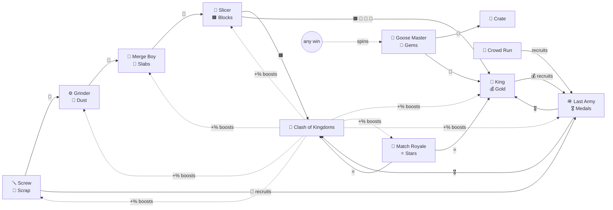

# Proposal: how MergeBoy's games link together

## The rule

**Every moment where a predatory game would ask for money becomes a reason to play a
different game.** The only real money in MergeBoy is an optional "buy the dev a coffee" link
(`MB.COFFEE_URL` in `js/data.js`), which unlocks nothing in-game.

This one rule gives the whole design its shape:

- The predatory moments stay in the game as **jokes**: lives, timers, "SO CLOSE!", energy bars,
  "FINISH NOW 💎".
- They work as the **glue**: each one points at another game, so every game stays useful
  for the whole run.
- They're **fair**: there's always an honest alternative too (wait a short, stated time, or just
  keep playing), and losing never takes back what you earned.

## What's on the phone now

| App | Parody of | Produces | Its paywall moment → what you do instead |
| --- | --- | --- | --- |
| 🪛 Screw Loose 3D | Screw Jam & clones | 🔩 Scrap | *(none, it's the raw source)* |
| ⚙️ Grind the Thing | idle tycoons | 💨 Dust | *(none)* |
| 👦 Merge Boy | merge-2 games | 🧱 Slabs | 💡 energy bar → errands |
| 🔪 Slice It All! | slicing hypercasual | 🟫 Blocks | *(none)* |
| 🤴 Rescue the King | Hero Wars / Homescapes pin ads | 💰 Gold + the main goal | 💡 Hint (💎) → merge slabs / clear a match-3 level |
| 🍬 Match Royale | Candy Crush / Royal Match | ⭐ Stars (+ a bit of everything) | Out of lives / "+5 moves" / hammers → errands |
| 🪖 Last Army: Merge War | Top War / Last War | 🎖️ Medals | Out of ⚡ / "SO CLOSE! Power Pack" → errands |
| 🏃 Crowd Run 3D | Count Masters, the Last War ad | Recruits → Last Army | Lost to the boss → "revive" errand |
| 🎰 Goose Master | Coin Master | 💎 Gems (via goose village) | Out of spins → **only** wins elsewhere give spins |
| 🏰 Clash of Kingdoms | Clash of Clans / 4X | Permanent boosts for other games | Build timers → hustle, intern "alliance help", errands |
| 🎁 Lucky Crate | gacha | random resources / interns | Out of 💎 → errands |
| 👑 VIP Store | IAP shops | jokes priced in resources | — |
| ☕ Dev Coffee | — | nothing, on purpose | the one real-money link |

## The links: seven mechanisms

1. **Production chain (inputs).** 🔩 → 💨 → 🧱 → 🟫 down the line. Last Army recruits cost
   🔩 + 💰.
2. **Salaries (a loop).** Each intern is paid per run in *another* game's resource:
   - Screw ← 💨
   - Grinder ← 🧱
   - Merge ← 🟫
   - Slicer ← 💰
   - Knight ← 🔩
   - Candy Intern ← 🎖️
   - Drill Sergeant ← ⭐

   A paid intern works 2×; an unpaid one quiet-quits at 1×. That loops the end of the chain back
   to the start, and Match Royale ↔ Last Army pay each other.
3. **Upgrade costs.** Each intern upgrade costs other games' resources. For example, Screw Lv2
   needs 🟫 and Lv4+ needs 💰.
4. **The main goal.** Rescue the King's 9 stages cost materials from across the phone. Late
   stages need ⭐ and 🎖️ too.
5. **Clash of Kingdoms boosts.** Buildings turn ⭐ 🎖️ 🟫 💰 into permanent +% for other games:
   - Workshop → 🪛⚙️
   - Lab → 👦🔪
   - Treasury → 🤴🍬
   - Barracks → 🪖
   - Candy Factory → +❤️/⚡ caps
   - Dorms → cheaper salaries

   The base is where resources become permanent.
6. **Errands (the paywall replacement).** `js/errands.js`:
   - A paywall screen shows a crossed-out real-world price and 2–4 errands in other games.
   - Accepting one jumps you to that game.
   - Errand progress shows on the home screen and inside the target game.
   - When it's done, the reward lands back where you came from: a paused Match Royale level gets
     its +5 moves, a building finishes, energy refills.
7. **Cross-game "any action" hooks.**
   - Every hand-played action anywhere knocks 10 s off construction ("hustle").
   - Every win anywhere gives a Goose Master spin.

   Playing *anything* moves *everything* forward a little.

**Manual play always beats automation.**

- Hand-played output is ×(1 + intern level) × King bonus × building bonus.
- An intern works 2× while you watch its game.
- Interns don't run errands.

## Proposed next

Based on the research ([RESEARCH.md](RESEARCH.md)), roughly in order of value:

| Next game | Parody of | How it would link |
| --- | --- | --- |
| **Board Lap** | Monopoly GO | Dice only from wins elsewhere; ×3 multiplier cap; sticker album with duplicate trade-in. Produces 💰 or ⭐; landmarks cost 🟫. |
| **Capsule Hero** | Raid / Genshin gacha | Summon tokens from Goose Master and King stages; odds + pity counter printed on the button; heroes give % boosts to Last Army. |
| **Keep Warm** | Whiteout Survival's furnace | A sink for 💨 Dust (as coal); telegraphed blizzards; "survivors" boost interns. Gives the grinder late-game purpose. |
| **Supply Run** + honest shop | State of Survival | Minesweeper-lite producing 🔩/💰; the shop shows "WAS $997.40" and tapping it reveals an honest price history. |
| **Survivor-lite** | Survivor.io | 3-minute arena run with no energy; when you hit a wall it names which game to play for the upgrade. |
| **Merge Boy energy** | Merge Mansion | Give Merge Boy a (fast) energy bar refilled by errands, the most famous paywall moment we don't parody yet. |

Smaller ideas from the research:

- A **resource web screen** that shows every resource's source and sinks (pattern #8: layered
  currencies).
- A **gacha pity counter** on Lucky Crate.
- A **goose celebrity endorsement** ad.

## Decisions for you

1. **Do lives stay?** The research suggests removing lives from match-3 entirely. I kept them
   because "out of lives" is the most recognisable paywall, and it's the best demo of errands.
   They're fast (10 min), and losing keeps your matches.
2. **The fake ads.** They interrupt opening an app (35%, at most every 75 s). That's the joke, but
   it's also an interruption. Options:
   - keep them as is,
   - make them opt-in only (the 2× boost button), or
   - add a setting.
3. **How many games?** There are now 13 icons. New players may want a slower unlock order, or a
   "folder" for side games (Crate, Goose Master, Crowd Run).
4. **Names.** "Clash of Kingdoms", "Last Army", "Match Royale" and "Goose Master" are meant as
   parody. If this ships publicly, a quick trademark/parody check would be worth it.
5. **Coffee link.** Set `MB.COFFEE_URL` when you have one. Until then the button says "coming
   soon".
6. **Balance.** None of the numbers have had a full-playthrough pass. `node tools/sim-economy.js
   [level] [hours]` runs the interns headlessly. Findings so far:
   - With every intern at the same level and nobody playing, nothing deadlocks; unpaid interns
     just work at 1×.
   - The **dust → slab** stretch is the bottleneck: the Grinder ends up unpaid 😒 (the Slicer
     eats every slab first), Merge and Slicer starve 💤, and scrap piles up.
   - That's arguably the design working: it tells you to play Merge Boy or Grind the Thing.
     Whether equal levels *should* balance is your call.

## Known gaps (as of this pass)

- **Not balanced end to end:** unlock costs, salaries and building prices are first guesses.
- **Thin flows:** Match Royale has no special tiles beyond the 🚀 row-clear (no bombs or
  colour-clears yet).
- **Old saves** carry over, but nothing migrates them. Use ⟲ to reset if something looks off.
